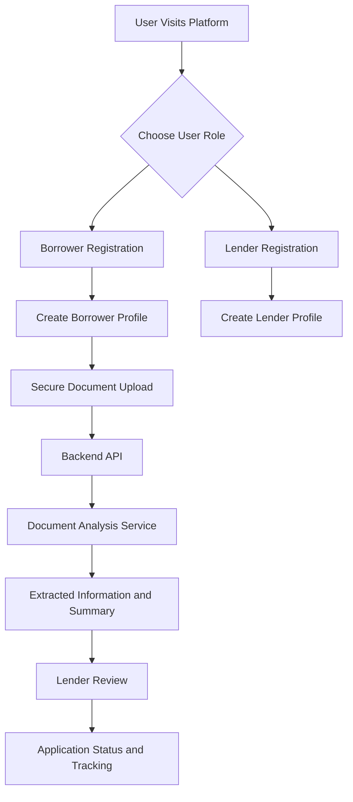
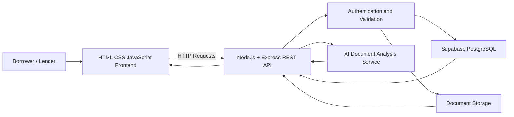

# VSBEC | Intelligent Borrower–Lender Platform

<p align="center">
  <strong>Bridging Borrowers and Lenders Through Intelligent Document Analysis</strong>
  <br />
  A smarter, faster, and more transparent approach to loan document processing.
</p>

<p align="center">
  
  
  
  
  
</p>

---

## Overview

Accessing financial services often involves complicated registration processes, multiple documents, repetitive data entry, and time-consuming manual verification. Borrowers need a convenient way to submit their information, while lenders need an organized and reliable way to review applications and supporting documents.

**VSBEC** is a web-based borrower–lender platform designed to simplify this process through structured user registration, secure document management, backend APIs, and AI-assisted document analysis.

The platform provides separate experiences for borrowers and lenders, helping organize financial information and supporting a more efficient document review workflow.

Our vision is to make loan application processing more accessible, organized, and transparent through technology.

## The Problem

Traditional loan application workflows can involve several challenges:

- **Complex documentation:** Borrowers must submit multiple documents in different formats.
- **Manual verification:** Reviewing documents individually can consume valuable time.
- **Fragmented information:** Applicant details and supporting documents may be difficult to organize.
- **Limited transparency:** Applicants may not have a clear view of their application progress.
- **Operational inefficiency:** Repetitive administrative tasks can slow down the review process.

## Our Solution

VSBEC brings borrower information, document submission, and lender-side review into a unified digital workflow.

### Key features

- **Separate borrower and lender profiles** with dedicated registration fields and workflows.
- **Structured registration** with required personal, contact, state, and city information.
- **Multiple document uploads** to collect the supporting files required for an application.
- **AI-assisted document analysis** to extract relevant information and summarize document contents.
- **Backend REST APIs** to connect the frontend, application logic, and database.
- **Centralized data management** using Supabase.
- **Secure document handling** designed around authentication, access control, and data protection.
- **Application tracking** to support clearer communication about review progress.

*Feature availability depends on the current implementation. Planned features should be completed and tested before being presented as production-ready.*

## How It Works



### Workflow

1. **Register:** Users create an account and provide the information required for their role.
2. **Build a profile:** Borrower and lender details are stored in their respective data structures.
3. **Upload documents:** Borrowers submit the required supporting documents.
4. **Process documents:** The backend validates uploads and sends eligible files to the document analysis service.
5. **Review results:** Extracted information and summaries are made available for authorized review.
6. **Track progress:** Application status can be communicated through the platform as the relevant workflow is implemented.

AI-generated results are intended to assist document review, not replace lender judgment or formal credit underwriting.

## Technology Stack

| Layer | Technology | Purpose |
|---|---|---|
| Frontend | HTML5 | Page structure and forms |
| Styling | CSS3 | Layout and responsive design |
| Client-side logic | JavaScript | Form validation and API requests |
| Backend | Node.js | Server-side JavaScript runtime |
| Backend framework | Express.js | REST APIs, routing, and middleware |
| Database | Supabase PostgreSQL | Structured application and profile data |
| Authentication | Supabase Auth or configured authentication service | User identity and sessions |
| Document storage | Supabase Storage or configured storage service | Supporting document files |
| AI analysis | Configured AI/document-processing API | Document extraction and analysis |
| Development | Git and GitHub | Version control and collaboration |
| Deployment | Configured hosting provider | Application hosting |

**Architecture principle:** The frontend communicates with the Express backend through HTTP APIs. The backend validates requests and coordinates database, storage, and document-processing operations.

## System Architecture



### Architectural responsibilities

- **Frontend:** Collects user input, displays application information, and communicates with backend endpoints.
- **Express backend:** Handles business logic, validation, authorization, and API responses.
- **PostgreSQL database:** Stores structured profiles, application metadata, and processing status.
- **Document storage:** Stores files separately from the structured database records.
- **AI service:** Assists with extracting and summarizing document content.
- **Authentication and authorization:** Restrict access to the resources a user is permitted to access.

## Database Design

The database is organized around distinct user roles and application workflows.

| Entity | Responsibility |
|---|---|
| `borrower_profiles` | Borrower registration and contact details |
| `lender_profiles` | Lender registration and organization details |
| `loan_applications` | Application details and workflow status, if enabled |
| `documents` | Document metadata, storage references, and processing status |
| `profiles` / authentication records | Shared account identity and role association, according to the selected schema |

The final schema should follow the actual database migrations and application code. Table names and relationships must be consistent across the backend and database.

### Data management principles

- Validate required fields before storing records.
- Use stable identifiers and appropriate foreign-key relationships.
- Keep document files in storage rather than placing large files directly in profile records.
- Associate uploaded documents with the correct user and application.
- Enforce authorization and database access policies.
- Avoid exposing sensitive financial or identity documents through public URLs.

## Document Analysis Pipeline

The document analysis component is designed to support the processing of uploaded files.

1. Receive a document through an authorized upload workflow.
2. Validate its file type, size, and upload permissions.
3. Store the file securely and record its metadata.
4. Extract text using a suitable parser, OCR engine, or document-processing service.
5. Send only the required content to the configured AI service.
6. Validate and structure the returned information.
7. Store the analysis status and permitted results.
8. Present the results to an authorized reviewer.

### Potential analysis outputs

- Document type identification.
- Extraction of relevant fields.
- Summary of document contents.
- Missing or unreadable information indicators.
- Inconsistencies that require manual review.
- Processing errors and retry status.

AI analysis does not establish that a document is authentic, that its contents are true, or that a borrower is creditworthy. Any financial decision requires appropriate independent verification.

## Security and Privacy

Financial documents can contain highly sensitive information. Security is therefore a core design requirement.

- Keep API secrets and service-role keys on the server.
- Store secrets in environment variables rather than source code.
- Validate and authorize every protected API request.
- Apply appropriate Supabase Row Level Security (RLS) policies.
- Enforce borrower and lender access boundaries.
- Validate file type and size; use safe upload handling.
- Avoid logging passwords, access tokens, or document contents.
- Use HTTPS in production.
- Define appropriate retention and deletion policies for uploaded documents.
- Handle AI-provider errors and avoid sending unnecessary personal information to external services.

Security controls must be configured and tested in the actual deployment before the platform is described as production-ready.

## Getting Started

Follow these instructions to run the project locally.

### Prerequisites

Install the following tools:

- Node.js and npm.
- Git.
- A Supabase project, if using Supabase for database and authentication.
- The credentials for any configured AI or document-processing provider.

### 1. Clone the repository

```bash
git clone <YOUR_GITHUB_REPOSITORY_URL>
cd <YOUR_PROJECT_FOLDER>
```

Replace the placeholders with your actual repository URL and project directory.

### 2. Install dependencies

```bash
npm install
```

Run this command in the directory containing the backend's `package.json`. If the frontend and backend have separate package files, install dependencies in each directory.

### 3. Configure environment variables

Create a `.env` file in the backend directory, using the project's existing environment variable names.

Example:

```env
PORT=3000
NODE_ENV=development

SUPABASE_URL=your_supabase_project_url
SUPABASE_ANON_KEY=your_supabase_anon_key

AI_API_KEY=your_ai_provider_api_key
```

Add other variables required by your actual configuration, such as a server-side Supabase service key or storage settings, only where needed.

**Important:** These are illustrative variable names. Match them to the code in your repository. Never commit real API keys, passwords, service-role keys, or private credentials to GitHub.

### 4. Start the backend

Use the script defined in your backend's `package.json`. For example:

```bash
npm run dev
```

If the project does not define a `dev` script, add the appropriate script for its configured server entry point.

### 5. Start the frontend

Open a second terminal and navigate to the frontend directory.

Use the command specified by the frontend's `package.json`. For a simple static frontend, you can use a local development server such as the VS Code Live Server extension.

### 6. Verify the application

Confirm that:

- The frontend loads successfully.
- Borrower and lender registration validate required fields.
- API requests reach the backend.
- Database records are stored correctly.
- Document uploads are authorized and retrievable by permitted users.
- Document analysis returns valid results when configured.
- Unauthorized users cannot access restricted records or files.

## Example API Structure

The following endpoints illustrate a possible REST API design. Their actual paths and request formats must match the implementation.

| Method | Endpoint | Purpose |
|---|---|---|
| `POST` | `/api/borrowers/register` | Register a borrower |
| `GET` | `/api/borrowers/:id` | Retrieve an authorized borrower profile |
| `POST` | `/api/lenders/register` | Register a lender |
| `GET` | `/api/lenders/:id` | Retrieve an authorized lender profile |
| `POST` | `/api/documents/upload` | Upload a document |
| `POST` | `/api/documents/:id/analyze` | Request document analysis |
| `GET` | `/api/documents/:id/status` | Retrieve processing status |

These are proposed endpoint examples, not a claim that every route already exists.

## Project Structure

A possible structure for the application is:

```text
VSBEC/
├── frontend/
│   ├── index.html
│   ├── css/
│   ├── js/
│   └── assets/
│
├── backend/
│   ├── src/
│   │   ├── routes/
│   │   ├── controllers/
│   │   ├── middleware/
│   │   ├── services/
│   │   ├── config/
│   │   └── app.js
│   ├── package.json
│   └── .env.example
│
├── docs/
│   └── architecture.md
├── .gitignore
└── README.md
```

Adapt this structure to the files and directories that actually exist in your repository.

## Challenges and Engineering Approach

The project explores several practical engineering challenges:

- **Role separation:** Designing independent borrower and lender experiences without duplicating shared functionality.
- **Reliable data storage:** Keeping profile fields and application records consistent.
- **Document processing:** Handling multiple uploads, extraction failures, and inconsistent file formats.
- **Frontend–backend integration:** Connecting browser-based forms to validated REST endpoints.
- **Privacy and access control:** Protecting sensitive files and restricting access to authorized users.
- **AI reliability:** Treating extracted information as potentially imperfect and supporting human review.

These challenges make the project a practical exploration of full-stack development, database design, API integration, and AI-assisted document workflows.

## Future Enhancements

- Automated document classification.
- OCR support for scanned PDFs and images.
- Configurable document checklists for different loan products.
- Application status notifications.
- A lender dashboard with document review tools.
- Improved application tracking and audit history.
- Multilingual document support.
- Accessibility improvements and responsive design.
- Automated testing, monitoring, and deployment pipelines.

These enhancements are roadmap items unless they have already been implemented.

## Team and Acknowledgements

**Project:** VSBEC — Intelligent Borrower–Lender Platform  
**Event:** 24-Hour Hackathon  
**Focus:** Full-Stack Development, Document Processing, and AI Integration

Built through collaborative problem-solving, rapid prototyping, and experimentation with modern web technologies.

**Team:** Add your official team name and member details here.

## Contributing

Contributions, suggestions, and bug reports are welcome.

1. Fork the repository.
2. Create a feature branch.
3. Implement and test your changes.
4. Commit your work with a descriptive message.
5. Open a pull request explaining the changes.

## License

Add an appropriate license before distributing or accepting external contributions. If you choose the MIT License, include a `LICENSE` file containing the complete license text.

---

<p align="center">
  <strong>Building a more organized and accessible borrower–lender experience, one document at a time.</strong>
</p>

<p align="center">
  If you find this project interesting, consider starring the repository and sharing your feedback.
</p>
