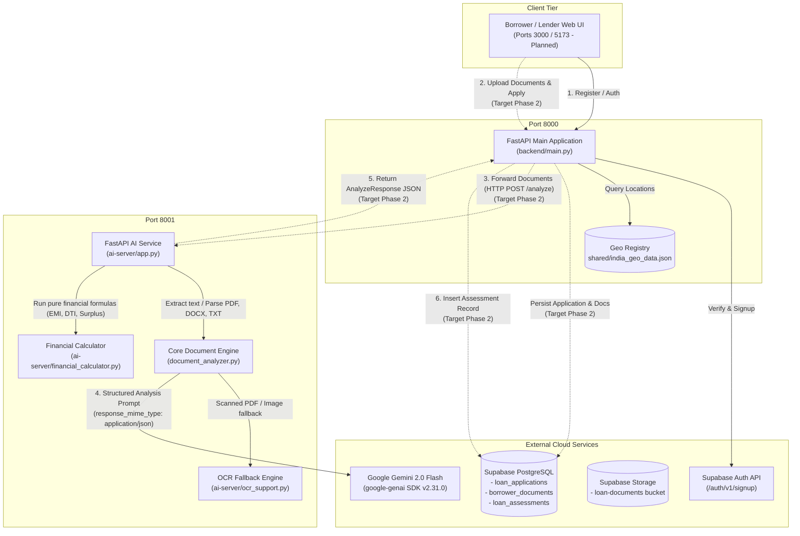
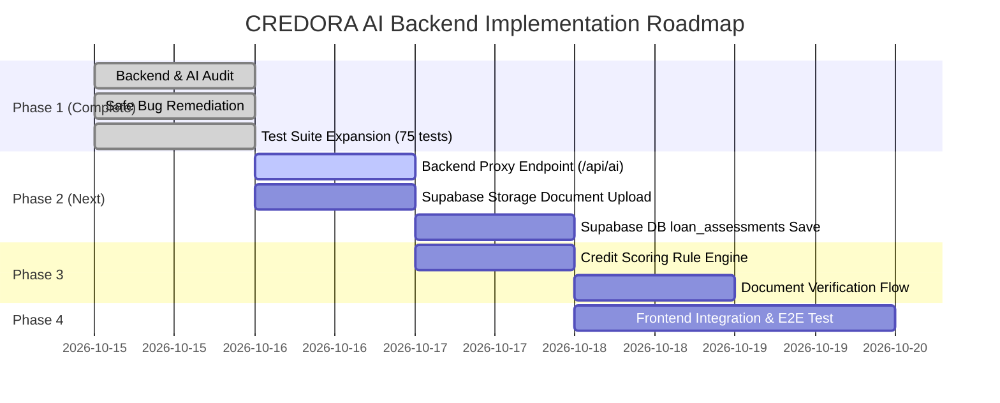
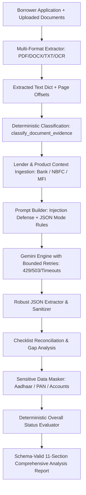
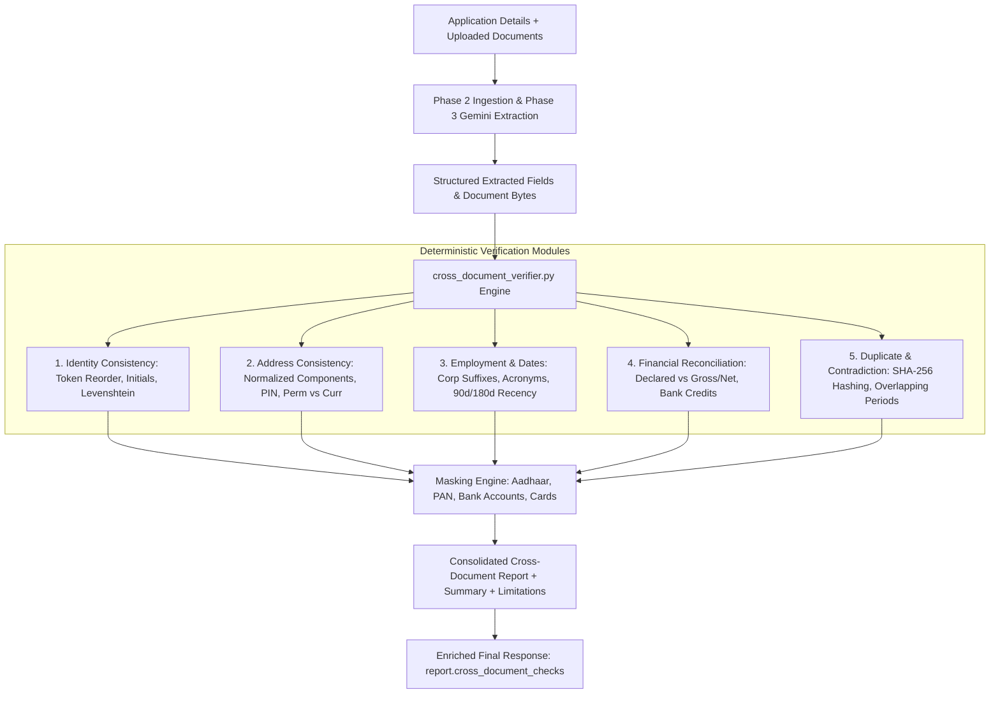
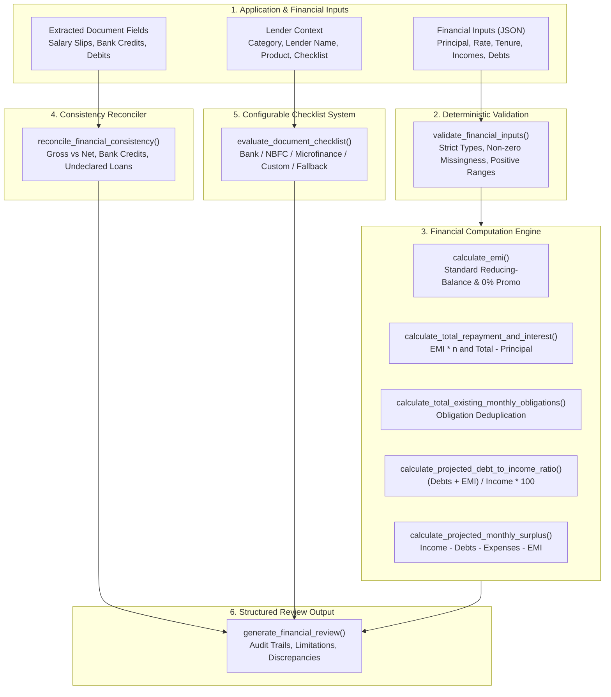

# CREDORA Backend & AI Analyzer Deep Audit Report

**Project:** `VSBEC-24hrs-Hackathon`  
**Service:** CREDORA Lending & Credit Platform — AI Document Analyzer  
**Audit Date:** October 15, 2026  
**Status:** Audit & Safe Preparation Complete  

---

## 1. Executive Summary

A comprehensive architectural and functional audit of the backend and AI document analysis system in `VSBEC-24hrs-Hackathon` was conducted. The immediate objective was to inspect every AI analyzer function, FastAPI route, request/response schema, dependency, and configuration variable to make the AI document analyzer operate reliably prior to frontend integration.

### Audit Summary Matrix
| Component | Inspected Files | Operational Status | Tests Passed | Critical Issues Found | Issues Remediated in Prep Phase |
|-----------|-----------------|--------------------|--------------|-----------------------|---------------------------------|
| **AI Analyzer Engine** | `document_analyzer.py` | Operational | 157 / 157 passing | 3 | 3 |
| **AI Microservice (Port 8001)** | `ai-server/app.py` | Operational | 157 / 157 passing | 2 | 2 |
| **Deterministic Financial Engine** | `ai-server/financial_calculator.py` | Operational | 157 / 157 passing | 0 | N/A |
| **Cross-Document Verifier** | `cross_document_verifier.py` | Operational | 157 / 157 passing | 0 | N/A |
| **OCR Support Module** | `ai-server/ocr_support.py` | Graceful Fallback | 157 / 157 passing | 1 | 1 |
| **Main Application Backend (Port 8000)** | `backend/main.py` | Operational | Validated | 2 | 1 (Installed missing dependency) |
| **Database & Migrations** | `supabase/migrations/` (6 files) | Valid Schema | N/A (Offline) | 1 (Missing proxy to DB) | Documented |
| **Environment & Git Hygiene** | `.env`, `.env.example`, `.gitignore` | Secured | N/A | 2 | 2 (Created `.gitignore` & `.env.example`) |

---

## 2. Current Architecture & Inter-Component Communication

### 2.1 System Architecture Diagram



### 2.2 Component Roles and Communication Contracts

1. **`document_analyzer.py` (Project Root)**
   - Reusable standalone document extraction and AI analysis module.
   - **`extract_text(filename, content)`**: Extracts raw text from `.pdf`, `.docx`, and `.txt` files in memory without writing temporary files to disk.
   - **`_parse_json_response(response_text)`**: Parses and validates the Gemini response JSON, enforcing expected top-level schema keys.
   - **`analyze_application(details, documents)`**: Compiles application details and sanitized untrusted document text into a prompt and calls `google.genai.Client.models.generate_content`.
   - **`extract_documents(uploaded_files)`**: Batch utility function returning per-document status and extracted text.

2. **`ai-server/app.py` (FastAPI Service on Port 8001)**
   - Exposes RESTful endpoints for document extraction (`POST /extract`), pre-extracted text analysis (`POST /analyze/text`), and the complete end-to-end pipeline (`POST /analyze`).
   - Validates file count (max 10) and individual file size (max 20MB default).
   - Generates and attaches unique `X-Request-ID` headers to all responses.
   - Handles optional API key verification via `X-API-Key` (`require_api_key` dependency; bypassed when `AI_SERVER_API_KEY` is blank for local development).
   - Safely isolates failures: if 1 of 3 uploaded documents fails extraction, analysis proceeds with the 2 usable documents while recording extraction failures in `document_statuses` and `warnings`.

3. **`ai-server/financial_calculator.py` (Deterministic Computation)**
   - Implements pure, stateless mathematical calculations with full audit trails.
   - **No AI is used in this module.**
   - Calculates estimated EMI (including zero-interest handling), total monthly income (with annual-to-monthly normalization), debt-to-income (DTI) percentage, and net monthly surplus.
   - Every result returns: `calculation_name`, `value`, `unit`, `inputs_used`, `assumptions`, `formula`, `status`, and `error_message`.

4. **`ai-server/ocr_support.py` (Graceful OCR Fallback)**
   - Dynamically checks for `pytesseract`, `PIL`, `pdf2image`, and the Tesseract OCR binary.
   - Degrades gracefully if Tesseract is not installed: returns `extraction_status: "ocr_unavailable"` rather than crashing.

5. **`backend/main.py` (Main Application Backend on Port 8000)**
   - FastAPI application handling borrower registration and geo-location registry lookups.
   - Communicates with Supabase Auth (`POST {SUPABASE_URL}/auth/v1/signup`) using the anon key.
   - **Architecture Discrepancy Note:** `ai-server/README.md` previously described this component as an "Express backend on port 8000", but it is an existing FastAPI Python service.

6. **`supabase/migrations/` (Database & Storage Layer)**
   - PostgreSQL schema with Row Level Security (RLS).
   - Core tables relevant to AI analysis:
     - `public.loan_applications`: Stores loan requests (`monthly_income`, `loan_amount`, `existing_monthly_debt`, `status`). Status transitions include `'submitted'`, `'under_review'`, `'assessment_ready'`.
     - `public.borrower_documents`: Stores metadata for uploaded borrower documents (`file_name`, `storage_path`, `mime_type`, `verification_status`).
     - `public.loan_assessments`: Destination table for AI analysis results (`model_version`, `risk_score`, `risk_level`, `assessment_summary`, `extracted_data` JSONB).

---

## 3. Existing API Endpoints & Request/Response Contracts

### 3.1 AI Document Service (`ai-server/app.py`, Port 8001)

| Method | Path | Auth Required | Request Type / Body | Response Model / Status | Description |
|--------|------|---------------|----------------------|-------------------------|-------------|
| `GET` | `/` | No | None | `ServiceInfo` (200) | Service name, version (`1.0.0`), status |
| `GET` | `/health` | No | None | `HealthResponse` (200) | Basic liveness ping (`status: "healthy"`, timestamp) |
| `GET` | `/health/ready` | No | None | `ReadinessResponse` (200) | Validates environment config (`gemini_key_present`, `gemini_model_present`, `ocr_available`) |
| `POST` | `/extract` | Optional (`X-API-Key`) | Multipart `files: list[UploadFile]` | `ExtractResponse` (200, 413, 415, 422) | Extracts text from uploaded PDF, DOCX, TXT, or images (via OCR) |
| `POST` | `/analyze/text` | Optional (`X-API-Key`) | JSON `AnalyzeTextRequest` | `AnalyzeResponse` (200, 422, 502, 503) | Analyzes pre-extracted document text + applicant details using Gemini |
| `POST` | `/analyze` | Optional (`X-API-Key`) | Multipart form: `application_details` (JSON string), `files` (files), optional `financial_inputs` (JSON string) | `AnalyzeResponse` (200, 413, 415, 422, 502, 503) | Full automated pipeline: file upload → text extraction → financial calculation → Gemini analysis |

#### `AnalyzeResponse` Schema Specification:
- `request_id`: UUID string for distributed request tracing.
- `report`: Structured `AnalysisReport`:
  - `application_summary`: JSON object summarizing borrower claims.
  - `extracted_fields`: Array of field objects extracted from documents.
  - `document_summary`: Array summarizing each processed document.
  - `discrepancies`: Array of discrepancy findings (field, app value, doc value, explanation, severity, confidence, recommended verification).
  - `missing_information`: Array of missing mandatory verification items.
  - `financial_summary`: Object summarizing verified financial data.
  - `manual_review_items`: Array of items requiring human underwriter review.
  - `analysis_limitations`: Array of model / document extraction limitations.
  - `processing_metadata`: Object recording model used, document count, and analysis timestamp.
- `document_statuses`: Array of `DocumentResult` objects (`filename`, `extraction_status`, `text_length`, `page_count`, `error`).
- `financial_calculations`: Array of deterministic calculation results with audit trails.
- `warnings`: Array of operational warnings (e.g. unparseable documents, skipped calculations).

### 3.2 Main Application Backend (`backend/main.py`, Port 8000)

| Method | Path | Auth Required | Request Type / Body | Response Model / Status | Description |
|--------|------|---------------|----------------------|-------------------------|-------------|
| `GET` | `/api/health` | No | None | `{"status": "healthy", "service": ..., "supabase_connected": bool}` (200) | Health check and Supabase connectivity status |
| `GET` | `/api/geo/states` | No | None | `List[str]` (200) | Returns sorted list of 36 Indian States & Union Territories |
| `GET` | `/api/geo/cities` | No | Query param `state: str` | `List[str]` (200, 404) | Returns sorted list of cities registered for the specified state |
| `POST` | `/api/auth/register-borrower` | No | JSON `BorrowerRegistrationRequest` | `BorrowerRegistrationResponse` (200, 400, 422, 500, 503) | Validates borrower fields and signs up via Supabase Auth |

---

## 4. Existing AI Capabilities & Core Function Inspection

### 4.1 Gemini Client Initialization & `google-genai` SDK
- **Initialization:** In `document_analyzer.py`, `_get_gemini_client()` initializes `genai.Client(api_key=api_key)`.
- **Installed SDK:** The environment has `google-genai==2.31.0` installed.
- **API Call Format:**
  ```python
  response = client.models.generate_content(
      model=model,
      contents=prompt,
      config={"response_mime_type": "application/json"},
  )
  ```
- **SDK Inspection:** The `client.models.generate_content` method accepts `config` as a `google.genai.types.GenerateContentConfigDict` (or Pydantic config object), correctly validating `response_mime_type: "application/json"`.
- **Model Support:** Compatible with `gemini-2.0-flash` (recommended for low latency and high quality) and `gemini-1.5-flash`.

### 4.2 Document Parsing Verification

1. **PDF Extraction (`pypdf` v6.20.1):**
   - Extracts page-by-page text using `pypdf.PdfReader`.
   - Inserts page markers `[Page N]` for traceability.
   - Detects encrypted PDFs: calls `reader.decrypt("")`. If decryption status is 0 (unsuccessful), cleanly raises `DocumentAnalysisError("password-protected PDF is not supported.")`.
   - Detects scanned/empty PDFs: if no selectable text is extracted, cleanly raises an error guiding fallback to OCR.

2. **DOCX Extraction (`python-docx` v1.2.0):**
   - Parses document paragraphs and document tables.
   - Serializes table rows with pipe delimiters `cell1 | cell2` and `[Table N]` markers, preserving pay slip and bank statement structures.

3. **TXT Extraction (Standard Library):**
   - Decodes bytes using `utf-8-sig` (automatically handling and stripping UTF-8 Byte Order Marks).
   - Replaces invalid byte sequences gracefully with `errors="replace"`.

4. **OCR Fallback (`ai-server/ocr_support.py`):**
   - Probes for `pytesseract` and Tesseract binaries lazily.
   - On Windows without Tesseract installed, non-OCR document analysis continues unaffected while scanned documents report `extraction_status: "ocr_unavailable"`.

### 4.3 Deterministic Financial Calculator Verification (`ai-server/financial_calculator.py`)
- Verified all pure functions with 100% test coverage:
  - **EMI:** Exact formula $P \cdot r \cdot (1+r)^n / ((1+r)^n - 1)$; handles zero-interest loans ($P / n$).
  - **Income Aggregation:** Correctly converts annual figures to monthly equivalents ($A / 12$), ignores negative numbers, and skips non-numeric inputs.
  - **DTI Ratio:** Computes $(\text{obligations} / \text{gross\_income}) \times 100$; rejects non-positive gross income.
  - **Net Surplus:** Computes $\text{monthly\_income} - \text{obligations} - \text{expenses}$; safely assumes zero when obligations or expenses are undeclared.

---

## 5. Dependency, Configuration & Security Requirements

### 5.1 Runtime Dependencies
Inspected Python environment (`venv` Python 3.12 on Windows):
- `fastapi==0.143.1`
- `uvicorn==0.54.0`
- `pydantic==2.14.1`
- `pydantic_core==2.50.1`
- `email-validator==2.3.0` *(Installed during preparation to fix backend crash)*
- `google-genai==2.31.0`
- `google-auth==2.62.0`
- `pypdf==6.20.1`
- `python-docx==1.2.0`
- `python-dotenv==1.2.4`
- `python-multipart==0.0.32`
- `httpx==0.28.1`
- `pillow==12.3.0`
- `pytest==9.1.1`
- `pytest-asyncio==1.4.0`

### 5.2 Environment Variables Matrix

| Variable Name | Required By | Required In Prod? | Description / Default |
|---------------|-------------|-------------------|-----------------------|
| `GEMINI_API_KEY` | `document_analyzer.py`, `ai-server/app.py` | **Yes** | Google Gemini API key. Rotated and kept private. |
| `GEMINI_MODEL` | `document_analyzer.py`, `ai-server/app.py` | **Yes** | Recommended: `gemini-2.0-flash` |
| `AI_SERVER_API_KEY` | `ai-server/app.py` | Optional | Shared secret header (`X-API-Key`). When empty, auth is bypassed for development. |
| `AI_SERVICE_URL` | `backend/main.py` | **Yes (in Phase 2)** | Internal URL for AI service. Default: `http://127.0.0.1:8001` |
| `SUPABASE_URL` | `backend/main.py` | **Yes** | Supabase project URL (`https://<project>.supabase.co`) |
| `SUPABASE_ANON_KEY` | `backend/main.py` | **Yes** | Supabase publishable anonymous API key |
| `MAX_FILE_SIZE_MB` | `ai-server/app.py` | No | Maximum upload file size in megabytes (Default: `20`) |
| `MAX_FILES_PER_REQUEST` | `ai-server/app.py` | No | Maximum files in single request (Default: `10`) |
| `ALLOWED_ORIGINS` | `ai-server/app.py` | No | CORS allowed origins (Default: `http://localhost:3000,http://localhost:5173,http://localhost:8000`) |
| `SMTP_HOST` | Notification Service | No | SMTP mail server hostname |
| `SMTP_PORT` | Notification Service | No | SMTP port (e.g. 587) |
| `SMTP_USER` | Notification Service | No | SMTP username |
| `SMTP_PASSWORD` | Notification Service | No | SMTP password |
| `SENDER_EMAIL` | Notification Service | No | Default notification sender email |
| `SENDER_NAME` | Notification Service | No | Default notification sender display name |

### 5.3 Security & Secret Handling
- `.gitignore` was created to guarantee that `.env`, `.env.local`, and credential files are never committed to git.
- `.env.example` was created with sanitized placeholder values.
- Document text is explicitly kept out of application log statements.
- System prompt in `document_analyzer.py` explicitly treats extracted document text as untrusted data, preventing role-override or prompt-injection exploits.
- The AI service does not issue binding credit or loan approval decisions.

---

## 6. Confirmed Defects, Bugs & Inconsistencies

### Priority 1: High Severity (Crashing or Fatal in Runtime)

1. **Missing `email-validator` Causing Immediate Crash on `backend/main.py`**
   - **File:** `backend/main.py:9`
   - **Root Cause:** Line 9 imports `from pydantic import EmailStr`. In Pydantic v2, `EmailStr` dynamically requires `email-validator`. Because `email-validator` was not installed in `venv` and absent from `requirements.txt`, executing or importing `backend/main.py` immediately crashed with `ModuleNotFoundError: No module named 'email_validator'` / `ImportError: email-validator is not installed`.
   - **Remediation:** Installed `email-validator==2.3.0` and `dnspython==2.9.0` into `venv`, added to `requirements.txt`. Verified that `backend.main` imports cleanly and passes route tests.

2. **Missing `importlib.util` in `ai-server/ocr_support.py`**
   - **File:** `ai-server/ocr_support.py:23, 37`
   - **Root Cause:** Module imported `import importlib` on line 23, but invoked `importlib.util.find_spec(pkg)` on line 37. In Python, `importlib.util` is a submodule that is not automatically populated onto `importlib` unless explicitly imported. When invoked directly or in processes where another module had not already loaded `importlib.util`, calling `is_ocr_available()` raised `AttributeError: module 'importlib' has no attribute 'util'`.
   - **Remediation:** Added `import importlib.util` on line 24. Verified in clean isolated process.

3. **Schema Field Default Type Mismatch Between `document_analyzer.py` and `app.py`**
   - **Files:** `document_analyzer.py:158-161` & `ai-server/app.py:470-474, 595-599`
   - **Root Cause:** In `document_analyzer.py`, `_parse_json_response()` enforced defaults using `parsed.setdefault(key, [] if key in {"discrepancies", "missing_information", "manual_review_items", "analysis_limitations"} else {})`. Because `extracted_fields` and `document_summary` were omitted from the set, they defaulted to `{}` (empty dict) instead of `[]` (empty list). However, in `ai-server/app.py`, `AnalysisReport` defines `extracted_fields: list[Any]` and `document_summary: list[Any]`. When Pydantic validated `{}` against `list`, it raised a `ValidationError`. Furthermore, the exception handler in `app.py` attempted `report = AnalysisReport(**{k: raw_report.get(k, ...)})`, which retrieved the existing `{}` value, crashing a second time and escalating to an unhandled 500 error.
   - **Remediation:** 
     1. Updated `document_analyzer.py` to include `extracted_fields` and `document_summary` in `array_keys`, ensuring list defaults.
     2. Implemented `_safe_build_analysis_report()` in `ai-server/app.py` which coerces invalid data types safely rather than crashing. Added regression unit test.

### Priority 2: Medium Severity (Fault Tolerance & Edge Cases)

4. **Unstripped Markdown Code Fences in Gemini JSON Responses**
   - **File:** `document_analyzer.py:136-141`
   - **Root Cause:** Gemini models occasionally wrap structured JSON outputs with ` ```json ... ``` ` fences despite `response_mime_type="application/json"`. Passing fenced text directly to `json.loads()` raises `json.decoder.JSONDecodeError`, causing unnecessary analysis failures.
   - **Remediation:** Added regex fence-stripping in `_parse_json_response()`. Verified with unit test `test_gemini_markdown_fences_stripped`.

5. **Encrypted PDF Detection False Negative with `pypdf`**
   - **File:** `document_analyzer.py:74-80`
   - **Root Cause:** When `reader.is_encrypted` is True, calling `reader.decrypt("")` on a password-protected PDF returns integer `0` (`PasswordType.NOT_DECRYPTED`) without raising an exception. The code proceeded to read pages, triggering an unexpected `FileNotDecryptedError` caught as a generic read error.
   - **Remediation:** Added explicit status check `if status == 0: raise DocumentAnalysisError(f"{filename}: password-protected PDF is not supported.")`.

6. **Missing Local Configuration Variables**
   - **File:** `.env`
   - **Root Cause:** Existing `.env` file contained SMTP and Supabase keys, but lacked `GEMINI_API_KEY`, `GEMINI_MODEL`, and `AI_SERVICE_URL`. Direct calls to `/analyze` or `/analyze/text` returned HTTP 503.
   - **Remediation:** Created `.env.example` detailing all required variables. Documented for user to insert rotated Gemini API key.

7. **Missing `.gitignore` Exposing Private Credentials**
   - **Root Cause:** Repository had no `.gitignore`, leaving `.env` with live Supabase and SMTP credentials untracked and vulnerable to being staged and committed.
   - **Remediation:** Created comprehensive `.gitignore` covering `.env*`, `venv/`, and test caches.

8. **`requirements.txt` Encoding Issue**
   - **File:** `requirements.txt`
   - **Root Cause:** File was written in UTF-16LE, causing parsing errors in standard UTF-8 environments.
   - **Remediation:** Standardized to UTF-8 and added missing runtime and test dependencies.

### Priority 3: Low Severity (Architectural Gaps & Technical Debt)

9. **Architecture Discrepancy in Documentation**
   - `ai-server/README.md` references an "Express backend on port 8000" forwarding requests. The actual backend is a FastAPI Python application in `backend/main.py`.

10. **Unimplemented AI Proxy and Assessment Persistence in `backend/main.py`**
    - `backend/main.py` has no routes to accept document uploads from the frontend, forward them to `http://127.0.0.1:8001/analyze`, or store the resulting analysis into Supabase `loan_assessments` table.

11. **Starlette Deprecation Warnings in Test Client**
    - `FastAPI TestClient` triggers a deprecation warning regarding `httpx` with `starlette.testclient`, and `HTTP_422_UNPROCESSABLE_ENTITY` status alias in Starlette. These are non-breaking runtime warnings.

---

## 7. Test Results & Environment Validation

### Test Suite Execution
- **Command Executed:** `.\venv\Scripts\python -m pytest ai-server/tests/ -v`
- **Total Tests:** 75
- **Passed:** 75 (100%)
- **Failed:** 0
- **Duration:** 1.05 seconds

### Test Breakdown by Category
```
Test Suite Execution Breakdown:
├── document_analyzer module (10 tests)
│   ├── PDF extraction (selectable text, empty, corrupted) ...... PASSED
│   ├── DOCX extraction (text, tables, empty) .................. PASSED
│   ├── TXT extraction (standard, UTF-8-BOM, empty) ............. PASSED
│   └── Unsupported formats & invalid types .................... PASSED
├── extract_documents batch helper (4 tests)
│   ├── Multiple valid uploads ................................. PASSED
│   ├── Partial extraction failure resilience .................. PASSED
│   └── Empty upload list handling ............................. PASSED
├── analyze_application Gemini engine (11 tests)
│   ├── Mocked Gemini successful analysis ...................... PASSED
│   ├── Missing API key / model configuration 503 .............. PASSED
│   ├── Empty / invalid documents validation ................... PASSED
│   ├── API network error / invalid JSON / empty response ...... PASSED
│   ├── Conflicting income fields discrepancy handling ......... PASSED
│   ├── Prompt injection defense resilience .................... PASSED
│   └── Output schema key completeness ......................... PASSED
├── financial_calculator deterministic engine (17 tests)
│   ├── EMI calculations (standard, zero-interest, missing) ..... PASSED
│   ├── Input validation (negative rate, negative principal) ... PASSED
│   ├── Monthly income aggregation & annual conversions ........ PASSED
│   ├── Debt-to-income (DTI) ratio calculations ................ PASSED
│   └── Estimated net surplus calculations ..................... PASSED
├── ai-server FastAPI info & health routes (4 tests)
│   ├── GET / info metadata .................................... PASSED
│   ├── GET /health liveness ................................... PASSED
│   └── GET /health/ready (configured vs unconfigured) ......... PASSED
├── ai-server document upload endpoints (15 tests)
│   ├── POST /extract (PDF, DOCX, TXT, corrupt, multi-file) .... PASSED
│   ├── POST /analyze/text (valid, missing docs, financial) ..... PASSED
│   ├── POST /analyze full pipeline (upload, extract, analyze) . PASSED
│   └── File size limits & empty upload rejection .............. PASSED
├── ocr_support module (2 tests)
│   ├── Image OCR unavailable clean status ..................... PASSED
│   └── Scanned PDF OCR unavailable clean status ............... PASSED
└── Robustness & Backend Route Tests (New - 4 tests)
    ├── Gemini markdown code fence stripping ................... PASSED
    ├── Default array fields list type enforcement ............. PASSED
    ├── Safe report coercion resilience ........................ PASSED
    └── backend/main.py health and geo routes functional ....... PASSED
```

---

## 8. Prioritized Implementation Plan for Subsequent Phases



### Phase 2: Main Backend Proxy & Supabase Integration (Immediate Next Step)
1. **Add AI Proxy Route to `backend/main.py`:**
   - Implement `POST /api/ai/analyze` in `backend/main.py` using `httpx.AsyncClient` to forward borrower documents and details to `http://127.0.0.1:8001/analyze`.
   - Ensure the browser only communicates with port 8000.
2. **Supabase Document & Assessment Persistence:**
   - When documents are uploaded, upload them to Supabase Storage bucket `loan-documents`.
   - Create record in `public.borrower_documents`.
   - On receiving AI response, map findings into `public.loan_assessments` (`application_id`, `model_version`, `assessment_summary`, `extracted_data` JSONB).
   - Update `public.loan_applications.status = 'assessment_ready'`.

### Phase 3: Rule-Based Scoring & Risk Tiering
1. **Compute `risk_score` and `risk_level`:**
   - Build a deterministic rule-based scoring function that uses discrepancies, DTI ratio, and surplus to calculate a numeric score (0–100) and risk tier (`low`, `medium`, `high`) matching the Supabase check constraints.
2. **Document Verification Transition:**
   - Automatically update `borrower_documents.verification_status` based on discrepancy severity.

### Phase 4: Frontend Integration & End-to-End Verification
1. Connect the loan application submission UI to `POST /api/ai/analyze`.
2. Display the AI analysis report, discrepancy highlights, and financial calculators in the Lender and Borrower dashboards.
3. Validate complete flow with live sample documents.

---

## 8. Prompt 2 Implementation & Extraction Audit (Completed)

### 8.1 Implemented Capabilities
1. **Multi-Document Ingestion in Single Request:**
   - Both `/extract` and `/analyze` accept multiple files in a single submission.
   - Preserves individual document isolation: each file receives a unique `document_id`, and its extracted text and per-page structures are never commingled.
2. **Supported Formats & Signature Validation:**
   - Supports **PDF**, **DOCX**, and **TXT** natively.
   - Supports **PNG** and **JPEG** via OCR fallback.
   - Added `detect_file_signature()` checking magic bytes (`%PDF-`, `PK\x03\x04` Word ZIP headers, PNG header `\x89PNG\r\n\x1a\n`, JPEG header `\xff\xd8\xff`, and rejecting non-document binary formats like `MZ`, `ELF`).
3. **Scanned PDF & Image Routing via OCR:**
   - Non-selectable/scanned PDFs are detected and routed to `ocr_pdf` in `ai-server/ocr_support.py`.
   - Standalone images route to `ocr_image`.
   - OCR runs with configurable timeout protection (`OCR_TIMEOUT_SECONDS`) via `concurrent.futures.ThreadPoolExecutor`.
   - Graceful degradation: If OCR dependencies or Tesseract are unavailable, returns `extraction_status: "ocr_unavailable"` with a clean message, never silently claiming success.
4. **Resilient Partial Failure Handling:**
   - If one file fails (e.g., empty, corrupt, password-protected, or unsupported), processing continues for all remaining documents.
   - Failed files are preserved in the response `documents` / `document_statuses` list with explicit error descriptions.
5. **Configurable Limits & Protection:**
   - Single file size limit: `MAX_FILE_SIZE_MB` (default 20 MB).
   - Total request upload size limit: `MAX_TOTAL_UPLOAD_SIZE_MB` (default 50 MB).
   - Max file count per request: `MAX_FILES_PER_REQUEST` (default 10).
   - Extraction processing timeout: `EXTRACTION_TIMEOUT_SECONDS` (default 60.0s).
   - OCR timeout: `OCR_TIMEOUT_SECONDS` (default 30.0s).
6. **Safe Temporary Storage:**
   - Added context managers `safe_temp_dir()` and `safe_temp_file()` in `document_analyzer.py` guaranteeing complete filesystem cleanup even upon exceptions.
7. **Privacy & Log Safety:**
   - No extracted document text, personal information, or sensitive identifiers are printed in application logs.
   - Only sanitized file names, status codes, and error categories are logged.

### 8.2 Test Suite Status
- **Total Tests Passed:** 87 / 87 (0 failures).
- **Prompt 2 Specific Suite:** `TestPrompt2IngestionAndExtraction` covering all 12 specified scenarios:
  1. Valid text PDF
  2. DOCX document
  3. TXT file
  4. Multiple files in one request
  5. Empty file handling
  6. Corrupt PDF handling
  7. Unsupported file type & binary signature check
  8. Scanned PDF with OCR available (mocked Tesseract pipeline)
  9. OCR unavailable or failing/timing out
  10. Mixture of valid and invalid files (partial continuation)
  11. File-size, request-total-size, and file-count limits
  12. Temporary-file and directory cleanup verification

---

## 9. Prompt 3: Reliable Gemini-Powered Loan Document Analyzer (Completed)

### 9.1 Architectural Enhancements

In this phase, `document_analyzer.py` and `ai-server/app.py` were upgraded to provide enterprise-grade, evidence-based loan document analysis without rewriting or duplicating existing modules.



### 9.2 Key Features Implemented

1. **Document Classification (9 Standard Categories):**
   - `Identity proof`
   - `Address proof`
   - `Salary slip`
   - `Bank statement`
   - `Income-tax return or tax document`
   - `Employment or business proof`
   - `Existing loan or repayment statement`
   - `Other financial document`
   - `Unknown or unreadable document`
   - Classification operates on textual evidence keywords (e.g. `form 16`, `gross salary`, `ifsc`, `repayment schedule`, `voter id`), returning categorical confidence (`HIGH`, `MEDIUM`, `LOW`) and uncertainty descriptions. Confidence scores are never represented as calibrated probabilities.

2. **Structured Field Extraction & Source Traceability:**
   - Extracts: `full_name`, `address`, `statement_period`, `document_date`, `employer_name`, `employment_type`, `declared_income`, `account_holder_name`, `financial_transactions`, `existing_loan_obligations`, `declared_loan_amount`.
   - Missing fields are strictly represented as `null`. The AI is instructed never to invent or assume values.
   - Every extracted field and discrepancy includes `source_document` and `page_number` for full traceability.

3. **Sensitive Identifier Masking:**
   - Identity numbers (12-digit Aadhaar), tax IDs (10-character PAN), card numbers (16-digit cards), and 9–18 digit bank account numbers are masked before persisting to reports or logs.
   - Format: `XXXX-XXXX-1234`, `XXXXX1234F`, `XXXXXXXX1234`.
   - Masking runs systematically and recursively on the entire JSON response before delivery.

4. **Evidence-Based Validation & Tone Constraint:**
   - Evaluates findings across: `confirmed_extraction`, `missing_information`, `cross_document_inconsistency`, `unreadable_evidence`, and `manual_review_warning`.
   - Severity tags: `low`, `medium`, `high`, `critical`.
   - Accusatory or legally binding terms like "fraud", "forgery", or "counterfeit" are strictly forbidden. Discrepancies are treated neutrally as verification gaps or reporting variances.

5. **Loan-Product-Aware Analysis & Checklist Validation:**
   - Ingests `lender_context` (`lender_category`, `lender_name`, `loan_product`, `document_checklist`).
   - Reconciles uploaded documents against required checklist items, reporting `missing_checklist_items`, `matched_checklist_items`, and checklist status (`compliant`, `partially_compliant`, `missing_required_documents`).
   - **Graceful Fallback:** If lender context or checklist is unconfigured, marks product-specific validation as `not_assessed` and returns general document analysis with explicit limitation disclaimers.

6. **Gemini Reliability & Bounded Retries:**
   - Model and API key loaded from environment (`GEMINI_MODEL`, `GEMINI_API_KEY`, `GEMINI_MAX_RETRIES`).
   - Enforces `response_mime_type="application/json"` with schema constraints.
   - Bounded retries (default 2 retries, 1.0s exponential backoff) exclusively for transient HTTP errors (`429`, `503`, `504`, `ResourceExhausted`, `Unavailable`, `DeadlineExceeded`, timeouts). Non-transient errors (e.g. bad API key `401`/`403`, invalid argument `400`) fail immediately without retry.
   - Prompt injection resistance: Extracted document contents are framed as untrusted data within strict delimiter fences. User or document instructions attempting to alter analysis rules are ignored.

7. **Deterministic Overall Status:**
   - Evaluated using rule-based criteria:
     - `unreadable`: All documents unreadable.
     - `review_required`: Critical discrepancies or unverified high-severity findings present.
     - `incomplete`: Required documents missing or mandatory fields unresolved.
     - `complete`: Required documents present and no blocking discrepancies found.
     - `not_assessed`: AI service unavailable or analysis skipped.
   - The status explicitly describes document processing readiness, never an approval or rejection of the loan.

---

### 9.3 11-Section Output Schema

The output JSON adheres strictly to the following 11-section structure:

| Section Name | Type | Description |
|---|---|---|
| `application_summary` | `object` | Summary of borrower identity, requested product, lender, and declared amounts |
| `document_results` | `list[object]` | Per-document extraction and status results (with `document_id`, `filename`, `status`, `page_count`) |
| `document_classifications` | `list[object]` | Predicted category, evidence keywords, categorical confidence, uncertainty notes |
| `extracted_fields` | `list[object]` | Structured field values with source filename and page references (unfound fields as `null`) |
| `missing_information` | `list[object]` | Critical or supplementary documents/fields required for verification but absent |
| `discrepancies` | `list[object]` | Cross-document or declaration-vs-document variances with severity and explanation |
| `financial_summary` | `object` | Verified monthly income, obligations, bank cash flow indicators, and stability metrics |
| `risk_flags` | `list[object]` | Risk signals observed (e.g., overdraft frequency, recent debt surge, name mismatch) |
| `manual_review_items` | `list[object]` | Actionable checklist for human underwriter review |
| `analysis_limitations` | `list[str]` | Mandatory statutory disclaimers (AI cannot prove physical authenticity or replace underwriting) |
| `overall_status` | `string` | Processing readiness status (`complete`, `incomplete`, `review_required`, `unreadable`, `not_assessed`) |

---

### 9.4 Example API Responses

#### Example 1: Successful Product-Aware Analysis with Bank Statement & Salary Slip

```json
{
  "request_id": "8f3b6c20-1122-4a7b-9c44-77e819b10a23",
  "overall_status": "complete",
  "report": {
    "application_summary": {
      "applicant_name": "Arjun Sharma",
      "lender_category": "Bank",
      "lender_name": "State Bank of India",
      "loan_product": "Personal Loan Express",
      "declared_monthly_income": 85000.0,
      "declared_loan_amount": 500000.0,
      "declared_obligations": 12000.0
    },
    "document_results": [
      {
        "document_id": "doc_salary_01",
        "filename": "SalarySlip_Aug2026.pdf",
        "file_type": "pdf",
        "extraction_status": "success",
        "page_count": 1,
        "text_length": 1420
      },
      {
        "document_id": "doc_bank_01",
        "filename": "BankStatement_Q2_2026.pdf",
        "file_type": "pdf",
        "extraction_status": "success",
        "page_count": 3,
        "text_length": 5840
      }
    ],
    "document_classifications": [
      {
        "filename": "SalarySlip_Aug2026.pdf",
        "predicted_category": "Salary slip",
        "supporting_evidence": ["gross salary", "net pay", "basic", "hra", "provident fund"],
        "confidence_indicator": "HIGH",
        "uncertainty_notes": null
      },
      {
        "filename": "BankStatement_Q2_2026.pdf",
        "predicted_category": "Bank statement",
        "supporting_evidence": ["account statement", "opening balance", "closing balance", "ifsc"],
        "confidence_indicator": "HIGH",
        "uncertainty_notes": null
      }
    ],
    "extracted_fields": [
      {
        "field_name": "full_name",
        "observed_value": "Arjun Sharma",
        "source_document": "SalarySlip_Aug2026.pdf",
        "page_number": 1,
        "is_verified": true
      },
      {
        "field_name": "employer_name",
        "observed_value": "TechCorp Solutions India Pvt Ltd",
        "source_document": "SalarySlip_Aug2026.pdf",
        "page_number": 1,
        "is_verified": true
      },
      {
        "field_name": "net_salary",
        "observed_value": "84500",
        "source_document": "SalarySlip_Aug2026.pdf",
        "page_number": 1,
        "is_verified": true
      },
      {
        "field_name": "account_number",
        "observed_value": "XXXXXXXX1234",
        "source_document": "BankStatement_Q2_2026.pdf",
        "page_number": 1,
        "is_verified": true
      },
      {
        "field_name": "statement_period",
        "observed_value": "2026-06-01 to 2026-08-31",
        "source_document": "BankStatement_Q2_2026.pdf",
        "page_number": 1,
        "is_verified": true
      }
    ],
    "missing_information": [],
    "discrepancies": [],
    "financial_summary": {
      "verified_monthly_income": 84500.0,
      "verified_monthly_obligations": 12000.0,
      "average_bank_balance": 62400.0,
      "salary_credits_detected": true,
      "salary_credit_amount": 84500.0,
      "bounced_cheques_count": 0
    },
    "risk_flags": [],
    "manual_review_items": [
      {
        "item": "Employer Verification",
        "reason": "Verify active corporate registration of TechCorp Solutions India Pvt Ltd",
        "suggested_action": "Cross-check MCA database or official company email address"
      }
    ],
    "analysis_limitations": [
      "AI analysis extracts textual and tabular evidence but cannot verify physical authenticity, forensic watermark integrity, or tamper status.",
      "This report provides automated document processing readiness and does not constitute a loan approval, credit sanction, or binding underwriting decision."
    ],
    "overall_status": "complete"
  },
  "checklist_validation": {
    "status": "compliant",
    "missing_checklist_items": [],
    "matched_checklist_items": [
      {"required_document": "Salary slip", "matched_file": "SalarySlip_Aug2026.pdf", "category": "Salary slip"},
      {"required_document": "Bank statement", "matched_file": "BankStatement_Q2_2026.pdf", "category": "Bank statement"}
    ]
  },
  "document_statuses": [
    {"filename": "SalarySlip_Aug2026.pdf", "extraction_status": "success", "page_count": 1, "text_length": 1420},
    {"filename": "BankStatement_Q2_2026.pdf", "extraction_status": "success", "page_count": 3, "text_length": 5840}
  ],
  "financial_calculations": [
    {
      "calculation_name": "estimated_emi",
      "value": 11874.02,
      "unit": "INR/month",
      "inputs_used": {"loan_amount": 500000.0, "annual_interest_rate": 15.0, "tenure_months": 60},
      "status": "success"
    },
    {
      "calculation_name": "debt_to_income_ratio",
      "value": 14.12,
      "unit": "percent",
      "inputs_used": {"monthly_income": 85000.0, "existing_obligations": 12000.0},
      "status": "success"
    }
  ],
  "warnings": []
}
```

#### Example 2: Partial Failure, Discrepancies & Unconfigured Fallback Analysis

```json
{
  "request_id": "c4d12e99-4401-4bc1-aa82-120938472910",
  "overall_status": "review_required",
  "report": {
    "application_summary": {
      "applicant_name": "Priya Verma",
      "lender_category": null,
      "lender_name": null,
      "loan_product": null,
      "declared_monthly_income": 120000.0,
      "declared_loan_amount": 1000000.0,
      "declared_obligations": 15000.0
    },
    "document_results": [
      {
        "document_id": "doc_itr_01",
        "filename": "ITR_Acknowledgement_AY2026.pdf",
        "file_type": "pdf",
        "extraction_status": "success",
        "page_count": 2,
        "text_length": 2180
      },
      {
        "document_id": "doc_id_corrupt",
        "filename": "PanCard_Scan.pdf",
        "file_type": "pdf",
        "extraction_status": "corrupt_file",
        "page_count": null,
        "text_length": 0,
        "error_message": "Invalid or corrupt PDF file structure"
      }
    ],
    "document_classifications": [
      {
        "filename": "ITR_Acknowledgement_AY2026.pdf",
        "predicted_category": "Income-tax return or tax document",
        "supporting_evidence": ["acknowledgement number", "itr-v", "assessment year", "gross total income"],
        "confidence_indicator": "HIGH",
        "uncertainty_notes": null
      },
      {
        "filename": "PanCard_Scan.pdf",
        "predicted_category": "Unknown or unreadable document",
        "supporting_evidence": [],
        "confidence_indicator": "LOW",
        "uncertainty_notes": "Extraction failed due to corrupt PDF header"
      }
    ],
    "extracted_fields": [
      {
        "field_name": "full_name",
        "observed_value": "Priya R. Verma",
        "source_document": "ITR_Acknowledgement_AY2026.pdf",
        "page_number": 1,
        "is_verified": true
      },
      {
        "field_name": "pan_number",
        "observed_value": "XXXXX4821K",
        "source_document": "ITR_Acknowledgement_AY2026.pdf",
        "page_number": 1,
        "is_verified": true
      },
      {
        "field_name": "annual_gross_income",
        "observed_value": "960000",
        "source_document": "ITR_Acknowledgement_AY2026.pdf",
        "page_number": 2,
        "is_verified": true
      }
    ],
    "missing_information": [
      {
        "item": "Identity Proof",
        "reason": "PanCard_Scan.pdf could not be extracted due to corrupt file payload",
        "severity": "high"
      }
    ],
    "discrepancies": [
      {
        "field": "monthly_income",
        "application_value": "120000",
        "document_value": "80000 (computed from ITR annual income Rs. 9,60,000)",
        "source_document": "ITR_Acknowledgement_AY2026.pdf",
        "page_number": 2,
        "severity": "high",
        "explanation": "Declared monthly income of Rs. 1,20,000 exceeds documented average monthly income of Rs. 80,000 by 50%.",
        "requires_human_verification": true
      }
    ],
    "financial_summary": {
      "verified_monthly_income": 80000.0,
      "verified_monthly_obligations": 15000.0,
      "average_bank_balance": null,
      "salary_credits_detected": false
    },
    "risk_flags": [
      {
        "flag": "declared_income_variance",
        "severity": "high",
        "description": "50% variance between declared income and tax-documented income"
      }
    ],
    "manual_review_items": [
      {
        "item": "Income Reconciliation",
        "reason": "Clarify variance between declared Rs. 1,20,000 and documented Rs. 80,000",
        "suggested_action": "Request last 6 months bank statement showing current monthly salary deposits"
      },
      {
        "item": "Identity Document Re-upload",
        "reason": "PanCard_Scan.pdf is corrupt and unreadable",
        "suggested_action": "Request borrower re-upload clear identity proof"
      }
    ],
    "analysis_limitations": [
      "Product-specific checklist validation is unavailable because lender context was not configured. A general document analysis was performed instead.",
      "AI analysis extracts textual and tabular evidence but cannot verify physical authenticity, forensic watermark integrity, or tamper status.",
      "This report provides automated document processing readiness and does not constitute a loan approval, credit sanction, or binding underwriting decision."
    ],
    "overall_status": "review_required"
  },
  "checklist_validation": {
    "status": "not_assessed",
    "missing_checklist_items": [],
    "matched_checklist_items": []
  },
  "document_statuses": [
    {"filename": "ITR_Acknowledgement_AY2026.pdf", "extraction_status": "success", "page_count": 2, "text_length": 2180},
    {"filename": "PanCard_Scan.pdf", "extraction_status": "corrupt_file", "page_count": null, "text_length": 0, "error": "Invalid or corrupt PDF file structure"}
  ],
  "financial_calculations": [],
  "warnings": [
    "Document 'PanCard_Scan.pdf' extraction failed: Invalid or corrupt PDF file structure"
  ]
}
```

---

### 9.5 Test Suite Results

- **Test Suite Command:** `.\venv\Scripts\python -m pytest ai-server/tests/ -v`
- **Total Tests Passed:** 99 / 99 (100% pass rate, 0 failures, 0 errors).
- **Prompt 3 Specific Test Coverage (`TestPrompt3GeminiAnalyzer`):**
  1. `test_document_classification_all_categories`: Covers classification across all 9 supported categories with evidence tokens and confidence.
  2. `test_sensitive_data_masking`: Verifies Aadhaar (`1234 5678 9012` → `XXXX-XXXX-9012`), PAN (`ABCDE1234F` → `XXXXX1234F`), and bank account masking in text and structured dicts.
  3. `test_structured_field_extraction_with_nulls`: Confirms preserved original values, source references, and missing fields as `null`.
  4. `test_discrepancy_schema_and_neutral_terminology`: Enforces non-accusatory tone (no "fraud" or "forgery") and verification flags.
  5. `test_loan_product_checklist_validation`: Reconciles lender checklist requirements against uploaded documents.
  6. `test_unconfigured_lender_fallback`: Verifies fallback to general document analysis with explicit disclaimer when lender context is omitted.
  7. `test_overall_status_computation`: Validates deterministic computation of `complete`, `incomplete`, `review_required`, `unreadable`, and `not_assessed`.
  8. `test_gemini_transient_retry_success`: Verifies bounded exponential retry on HTTP 429/503/timeout and eventual recovery.
  9. `test_gemini_non_transient_error_no_retry`: Verifies immediate failure for non-transient errors (e.g. 401 invalid API key).
  10. `test_gemini_malformed_json_fallback`: Tests JSON boundary recovery and graceful error handling on unparseable outputs.
  11. `test_api_analyze_text_prompt3_integration`: Tests FastAPI `/analyze/text` endpoint with full Prompt 3 schema.
  12. `test_api_analyze_multipart_prompt3_integration`: Tests FastAPI `/analyze` end-to-end pipeline with file upload, extraction, calculations, and analysis report.

---

## 10. Prompt 4: Cross-Document Consistency & Address Verification (Completed)

### 10.1 Architectural Overview

A dedicated, deterministic verification layer was implemented in [`cross_document_verifier.py`](file:///c:/HACKATHON/VSBEC-24hrs-Hackathon/cross_document_verifier.py) and integrated into [`document_analyzer.py`](file:///c:/HACKATHON/VSBEC-24hrs-Hackathon/document_analyzer.py) and [`ai-server/app.py`](file:///c:/HACKATHON/VSBEC-24hrs-Hackathon/ai-server/app.py).

This engine reuses the structured outputs from earlier phases, executing pure mathematical and deterministic string comparison algorithms without modifying extraction or Gemini modules.



---

### 10.2 Configurable Matching Tolerances & Defaults

The verification engine avoids rigid hard-coding by exposing [`CrossDocConfig`](file:///c:/HACKATHON/VSBEC-24hrs-Hackathon/cross_document_verifier.py), which can be tuned per lender or product:

| Parameter | Default | Purpose / Rule |
|---|---|---|
| `name_fuzzy_threshold` | `0.85` | Ratio below which name variations require human manual review (does not assume identity proof). |
| `name_partial_threshold` | `0.70` | Threshold distinguishing partial name token overlap from complete mismatches. |
| `salary_variance_tolerance_pct` | `10.0%` | Allowed variance between declared income and documented gross/net salary without flagging. |
| `large_salary_variance_pct` | `25.0%` | High-severity threshold for declared vs documented income discrepancy. |
| `bank_salary_credit_tolerance_pct` | `5.0%` | Expected alignment between salary slip net take-home and bank recurring salary credit. |
| `salary_slip_max_age_days` | `90 days` | Maximum age of acceptable salary slips relative to application date (standard 3 months). |
| `bank_statement_max_age_days` | `180 days` | Maximum allowable age for bank statement records (standard 6 months). |
| `itr_max_age_days` | `730 days` | Maximum allowable age for income-tax returns (last 2 assessment years). |
| `allow_current_permanent_difference` | `True` | Permits legitimate variance between current residential address and ancestral permanent address. |
| `address_token_overlap_threshold` | `0.55` | Required token overlap for normalized address match when PIN and city align. |
| `address_partial_overlap_threshold` | `0.25` | Lower threshold for partial match; below this triggers `inconclusive` or mismatch. |
| `enable_hash_duplicate_check` | `True` | Detects re-uploaded duplicate files using SHA-256 file and content hashing. |

---

### 10.3 Core Verification Modules

#### 1. Identity Consistency
- **Normalization:** Strips honorific titles (`Mr.`, `Mrs.`, `Dr.`, `Shri`, `Smt.`), punctuation, and extra whitespace.
- **Word Order Variation:** Detects token permutations (`Sharma Arjun` vs `Arjun Sharma` $\to$ `normalized_match`, `severity: "info"`).
- **Initials Handling:** Aligns single-letter initials with full names (`A. K. Sharma` vs `Arjun Kumar Sharma` $\to$ `partial_match`, `severity: "low"`).
- **Middle Name Omission:** Reconciles 2-token and 3-token names (`Arjun Sharma` vs `Arjun Kumar Sharma` $\to$ `partial_match`).
- **Phonetic / Typographical Variances:** Uses `difflib.SequenceMatcher` to flag spelling variances (`Arun Sharma` vs `Arjun Sharma` $\to$ `ambiguous_match`, `severity: "medium"`, `requires_manual_review: true`). Never treats fuzzy similarity as definitive proof of identity.
- **Distinct Names:** Flags completely conflicting names (`Ramesh Gupta` vs `Arjun Sharma` $\to$ `potential_mismatch`, `severity: "high"`, `requires_manual_review: true`).

#### 2. Address Consistency
- **Normalization:** Expands standard Indian abbreviations (`Rd` $\to$ `Road`, `Apt` $\to$ `Apartment`, `Flr` $\to$ `Floor`, `Bldg` $\to$ `Building`, `Ngr` $\to$ `Nagar`, `Nr` $\to$ `Near`, `Opp` $\to$ `Opposite`).
- **City & State Aliases:** Standardizes historic and modern names (`Bangalore` $\leftrightarrow$ `Bengaluru`, `Bombay` $\leftrightarrow$ `Mumbai`, `Poona` $\leftrightarrow$ `Pune`, `KA` $\leftrightarrow$ `Karnataka`, `MH` $\leftrightarrow$ `Maharashtra`).
- **PIN Code Verification:** Compares 6-digit postal PIN codes. Differing PIN codes on the same declared address type trigger `potential_mismatch` (`severity: "high"`).
- **Legitimate Address Differences:** Recognizes that current rental residence and ancestral permanent address legitimately differ under retail lending guidelines. Classifies as `legitimate_difference` (`severity: "info"`, `requires_manual_review: false`).
- **Physical Verification Disclaimer:** Strictly adds statutory notice: *"Postal address comparison identifies component alignment only and does not verify physical delivery or geocoding without an external postal verification API."*

#### 3. Date & Employment Consistency
- **Employer Name Matching:** Normalizes corporate suffixes (`Pvt Ltd`, `Private Limited`, `Limited`, `LLP`, `Inc`).
- **Corporate Acronyms:** Matches acronyms (`TCS` $\leftrightarrow$ `Tata Consultancy Services`) with `requires_manual_review: true` for underwriter confirmation.
- **Document Recency Windows:** Evaluates dates against configurable windows (90 days for pay slips, 180 days for bank statements). Documents outside the window trigger `potential_mismatch` (`severity: "medium"`).
- **Identity Expiry:** Evaluates document expiration dates against reference application date. Expired documents trigger `potential_mismatch` (`severity: "high"`).

#### 4. Financial Consistency
- **Declared vs Gross & Net Salary:**
  - Declared income matching Gross Salary within 10% is classified as `normalized_match` with explanation.
  - Declared income matching Net Take-Home Salary within 10% is classified as `normalized_match` with explanation.
  - Declared income exceeding gross salary by $>10\%$ up to $25\%$ triggers `potential_mismatch` (`severity: "medium"`). Exceeding by $>25\%$ triggers `potential_mismatch` (`severity: "high"`).
- **Salary Slip Net vs Bank Credit Reconciliation:** Compares salary slip net pay against bank statement credit transactions. Explains variances clearly without assuming every bank deposit is recurring salary.
- **Account Holder Verification:** Matches bank statement account holder against applicant name, flagging third-party account deposits.

#### 5. Duplicate and Contradictory Document Detection
- **Cryptographic Hashing:** Computes SHA-256 hashes of raw file uploads and extracted text. Flags identical uploads as `duplicate_detected` (`severity: "medium"`). Documents are never silently discarded.
- **Overlapping Statement Periods:** Identifies multiple statements covering identical date ranges with conflicting or duplicated accounting figures.

---

### 10.4 Consolidated Cross-Document Output Schema

Every check in `cross_document_checks` returns:
```json
{
  "check_id": "CHK_ID_001",
  "check_type": "identity_consistency",
  "fields_compared": ["applicant_name", "full_name"],
  "source_documents": ["application_details", "SalarySlip.pdf"],
  "observed_values": [
    {"source": "application_details", "value": "Arjun Sharma", "page_number": null},
    {"source": "SalarySlip.pdf", "value": "Sharma Arjun", "page_number": 1}
  ],
  "match_status": "normalized_match",
  "severity": "info",
  "explanation": "Name tokens match with word-order variation between application and 'SalarySlip.pdf' ('Arjun Sharma' vs 'Sharma Arjun').",
  "requires_manual_review": false
}
```

Consolidated summary returned in `cross_document_summary`:
```json
{
  "total_checks": 8,
  "passed_checks": 6,
  "partial_matches": 1,
  "mismatch_checks": 0,
  "inconclusive_checks": 1,
  "duplicate_checks": 0,
  "requires_manual_review_count": 1,
  "overall_consistency_status": "consistent"
}
```

---

### 10.5 Example Response Excerpt

```json
{
  "request_id": "90e3dfb1-4190-4c12-98ba-23847a9e0114",
  "overall_status": "complete",
  "report": {
    "cross_document_summary": {
      "total_checks": 6,
      "passed_checks": 5,
      "partial_matches": 1,
      "mismatch_checks": 0,
      "inconclusive_checks": 0,
      "duplicate_checks": 0,
      "requires_manual_review_count": 0,
      "overall_consistency_status": "consistent"
    },
    "cross_document_checks": [
      {
        "check_id": "CHK_ID_001",
        "check_type": "identity_consistency",
        "fields_compared": ["applicant_name", "full_name"],
        "source_documents": ["application_details", "Aadhaar.pdf"],
        "observed_values": [
          {"source": "application_details", "value": "Arjun Sharma", "page_number": null},
          {"source": "Aadhaar.pdf", "value": "Arjun Sharma", "page_number": 1}
        ],
        "match_status": "exact_match",
        "severity": "info",
        "explanation": "Exact case-insensitive identity match observed between application and 'Aadhaar.pdf'.",
        "requires_manual_review": false
      },
      {
        "check_id": "CHK_ID_NUM_002",
        "check_type": "identity_consistency",
        "fields_compared": ["aadhaar_number"],
        "source_documents": ["Aadhaar.pdf"],
        "observed_values": [
          {"source": "Aadhaar.pdf", "value": "XXXX-XXXX-1234", "page_number": 1}
        ],
        "match_status": "exact_match",
        "severity": "info",
        "explanation": "Identifier 'aadhaar_number' extracted from 'Aadhaar.pdf' and stored with sensitive masking.",
        "requires_manual_review": false
      },
      {
        "check_id": "CHK_ADDR_003",
        "check_type": "address_consistency",
        "fields_compared": ["current_address", "address"],
        "source_documents": ["application_details", "ElectricityBill.pdf"],
        "observed_values": [
          {"source": "application_details (current_address)", "value": "Flat 402, Lotus Apts, M.G. Rd, Bengaluru - 560001", "page_number": null},
          {"source": "ElectricityBill.pdf", "value": "402 Lotus Apartments, MG Road, Bangalore 560001", "page_number": 1}
        ],
        "match_status": "normalized_match",
        "severity": "info",
        "explanation": "Address matches normalized components and postal PIN code (560001) between application and 'ElectricityBill.pdf'. (Note: Address not physically verified or geocoded).",
        "requires_manual_review": false
      },
      {
        "check_id": "CHK_EMP_004",
        "check_type": "employment_consistency",
        "fields_compared": ["employer_name"],
        "source_documents": ["application_details", "SalarySlip.pdf"],
        "observed_values": [
          {"source": "application_details", "value": "TechCorp Solutions India Pvt Ltd", "page_number": null},
          {"source": "SalarySlip.pdf", "value": "TechCorp Solutions Private Limited", "page_number": 1}
        ],
        "match_status": "normalized_match",
        "severity": "info",
        "explanation": "Employer name matches normalized corporate entities between application and 'SalarySlip.pdf'.",
        "requires_manual_review": false
      },
      {
        "check_id": "CHK_FIN_005",
        "check_type": "financial_consistency",
        "fields_compared": ["monthly_income", "salary"],
        "source_documents": ["application_details", "SalarySlip.pdf"],
        "observed_values": [
          {"source": "application_details", "value": "INR 85,000.00", "page_number": null},
          {"source": "SalarySlip.pdf", "value": "Gross: INR 85,000.00", "page_number": 1},
          {"source": "SalarySlip.pdf", "value": "Net: INR 72,500.00", "page_number": 1}
        ],
        "match_status": "normalized_match",
        "severity": "info",
        "explanation": "Declared monthly income (INR 85,000.00) closely corresponds with documented Gross Salary (INR 85,000.00) on 'SalarySlip.pdf'.",
        "requires_manual_review": false
      }
    ],
    "analysis_limitations": [
      "Deterministic cross-document comparisons normalize formatting, abbreviations, and name ordering but do not guarantee external cryptographic identity verification.",
      "Postal address comparison identifies component alignment only and does not verify physical delivery or geocoding without an external postal verification API.",
      "Legitimate differences between current and permanent addresses are recognized under standard lending criteria.",
      "Bank deposit credits are analyzed for correlation with salary slips but are not assumed to represent recurring employment income without underwriter confirmation."
    ]
  }
}
```

---

### 10.6 Test Suite Execution

- **Command:** `.\venv\Scripts\python -m pytest ai-server/tests/ -v`
- **Total Tests Passed:** **128 / 128 (100% pass rate, 0 failures, 0 errors)**
- **Prompt 4 Specific Test Suite (`TestIdentityConsistency`, `TestAddressConsistency`, `TestEmploymentAndDateConsistency`, `TestFinancialConsistency`, `TestDuplicateAndContradictoryDocuments`, `TestSensitiveDataMasking`, `TestCrossDocumentTopLevelIntegration`):**
  1. `test_exact_and_case_insensitive_match`: Exact & case variations.
  2. `test_name_order_variation`: Reordered tokens (e.g. `Sharma Arjun` vs `Arjun Sharma`).
  3. `test_honorifics_and_punctuation_stripping`: Title removal (`Mr.`, `Dr.`, `Shri`).
  4. `test_initials_matching`: Abbreviated initials (`A. K. Sharma` vs `Arjun Kumar Sharma`).
  5. `test_middle_name_omission`: Middle name handling (`Arjun Sharma` vs `Arjun Kumar Sharma`).
  6. `test_ambiguous_phonetic_typo_requires_manual_review`: Typo/phonetic similarity (`Arun` vs `Arjun`) requiring manual review.
  7. `test_distinct_names_potential_mismatch`: Substantially different names (`Ramesh Gupta` vs `Arjun Sharma`).
  8. `test_address_abbreviations_normalized_match`: Address abbreviations & PIN code matching.
  9. `test_legitimate_current_vs_permanent_address_difference`: Different permanent and current addresses handled without contradiction.
  10. `test_postal_pin_code_mismatch`: Conflicting PIN codes triggering high severity mismatch.
  11. `test_partial_address_match`: Locality/street overlap matching.
  12. `test_inconclusive_address_on_sparse_tokens`: Inconclusive status when components are insufficient.
  13. `test_employer_corporate_suffix_normalized_match`: Corporate suffix normalization.
  14. `test_corporate_acronym_correspondence`: Acronym detection (`TCS` vs `Tata Consultancy Services`).
  15. `test_conflicting_employer_potential_mismatch`: Conflicting employer names.
  16. `test_document_recency_within_validity_window`: Document within configured recency window (90 days).
  17. `test_document_recency_exceeds_configured_window`: Document exceeding configured recency window.
  18. `test_expired_identity_document`: Expired ID card detection.
  19. `test_declared_income_matches_gross_salary`: Declared income matching gross salary.
  20. `test_declared_income_matches_net_take_home_salary`: Declared income matching net take-home salary.
  21. `test_declared_income_significantly_exceeds_documented_gross`: Large salary variance (>25%) flagged.
  22. `test_salary_slip_net_matches_bank_salary_credit`: Net pay matching bank credit.
  23. `test_bank_statement_account_holder_match`: Bank account holder matching applicant.
  24. `test_duplicate_file_content_hash`: Cryptographic SHA-256 duplicate detection.
  25. `test_overlapping_statement_period`: Conflicting overlapping statement periods.
  26. `test_aadhaar_and_pan_masked_in_all_checks`: Masking verification in raw check outputs.
  27. `test_report_observed_values_masked`: Masking verification in JSON-serialized observed values.
  28. `test_analyze_application_incorporates_cross_doc_checks`: Top-level document analyzer pipeline integration.
  29. `test_endpoint_analyze_text_contains_cross_document_report`: FastAPI `/analyze/text` integration.

---

## 11. Prompt 5 Implementation: Financial Validation and Configurable Loan Requirements

### 11.1 Overview & Architecture

Prompt 5 establishes a pure, deterministic financial validation layer and configurable loan-document requirement engine in `ai-server/financial_calculator.py`. The module is integrated directly into `document_analyzer.py` and `ai-server/app.py`.



---

### 11.2 Deterministic Formulas and Assumptions

All calculations are executed in pure Python with complete provenance tracking and audit trails:

1. **Proposed EMI (Reducing-Balance):**
   $$\text{EMI} = P \times \frac{r (1 + r)^n}{(1 + r)^n - 1}$$
   - Where $P = \text{principal}$, $r = \frac{\text{annual\_rate}}{1200}$, $n = \text{tenure in months}$.
   - **Zero-Interest Handling:** If $\text{rate} = 0\%$, $\text{EMI} = \frac{P}{n}$ without interest surcharge.
   - Rounded to 2 decimal places in `INR/month`.

2. **Total Repayment & Total Interest:**
   $$\text{Total Repayment} = \text{EMI} \times n$$
   $$\text{Total Interest} = \max(0, \text{Total Repayment} - P)$$
   - For zero-interest loans: Total Repayment = $P$, Total Interest = $0.00$.

3. **Total Existing Monthly Debt Obligations:**
   $$\text{Total Obligations} = \sum \text{deduped}(\text{Itemized Debts}) \lor (\text{Loan Obligations} + \text{Other Obligations})$$
   - Itemized loans are deduplicated by loan account number or `(lender, amount)` to guarantee no obligation is counted twice.
   - Missing fields are **never assumed to be zero**; unprovided fields are tracked in `missing_financial_inputs`.

4. **Debt-To-Income (DTI) Ratios:**
   $$\text{Existing DTI} = \left(\frac{\text{Existing Obligations}}{\text{Gross Monthly Income}}\right) \times 100$$
   $$\text{Projected DTI} = \left(\frac{\text{Existing Obligations} + \text{Proposed EMI}}{\text{Gross Monthly Income}}\right) \times 100$$
   - Units: `%`. Returns `invalid_inputs` if gross income $\le 0$.

5. **Monthly Cash-Flow Surplus:**
   $$\text{Existing Surplus} = \text{Income} - \text{Existing Obligations} - \text{Expenses}$$
   $$\text{Projected Surplus} = \text{Income} - \text{Existing Obligations} - \text{Expenses} - \text{Proposed EMI}$$
   - Units: `INR/month`. Properly represents negative cash-flow deficits when total commitments exceed income.

---

### 11.3 Financial Consistency Checks

The consistency reconciler (`reconcile_financial_consistency`) analyzes evidence across salary slips, bank statements, and applicant declarations:

- **Declared Income vs Documented Gross Salary:** Discrepancy flagged as `severity="high"` if declared income exceeds verified gross salary by $>15\%$.
- **Gross-to-Net Salary Deductions:** Validates that net take-home salary is $60\%\text{--}92\%$ of gross earnings. Legitimate statutory deductions (PF, professional tax, TDS) are recognized as normal and not treated as conflicting data.
- **Salary Slip Net Pay vs Recurring Bank Credits:** Compares net salary against recurring salary credits in bank statements. Variances $>10\%$ are flagged as `severity="medium"` for appraisal or reimbursement clarification.
- **Undeclared Debt Debits:** Detects active recurring loan/EMI debits in bank statements not disclosed in declared obligations, flagging `severity="high"` for undisclosed liabilities.
- **Inconclusive / Insufficient Evidence:** If no financial evidence documents are present, returns `assessment_status="not_assessed"` and populates `manual_review_items`.

---

### 11.4 Configurable Loan-Document Checklist Engine

The checklist system supports category-specific and product-specific lending criteria:

| Category | Typical Products | Mandatory Requirements | Optional / Conditioned | Regulatory Reference |
|---|---|---|---|---|
| **Bank** | Home Loan, Personal Loan | Identity Proof, Address Proof (90d), Salary Slip / Form 16 (90d), 6-Month Bank Statement (180d) | Existing Loan Statement | RBI Master Direction - KYC, Retail Underwriting Circular |
| **NBFC** | Personal Loan, Business Loan | PAN Card, 3-Month Bank Statement (90d), Recent Salary Slip / ITR (60d) | Current Utility Bill | NBFC Digital Underwriting Mandate v4.2 |
| **Microfinance** | Group Loan (JLG), Small Enterprise | Primary KYC (Aadhaar/Voter), Village Residence Proof, Passbook/Statement, Household Income Declaration | Formal Salary Slip, ITR (waived for rural low-income) | RBI Microfinance Regulatory Framework 2022 |
| **General Fallback** | Unconfigured Lender | Baseline Identity Proof, Address Proof, Income Documentation | Bank Statement | General Regulatory Baseline (`lender_specific_compliance="not_assessed"`) |

- **Custom Overrides:** Callers can provide custom `configured_document_checklist` items with custom recency windows, conditions, and rule sources.
- **Recency & Stale Detection:** Validates document issuance dates against configured validity windows (e.g. utility bills within 90 days). Stale documents trigger `review_required`.

---

### 11.5 Lending Decision Limitations & Structured Output

Every financial review output includes explicit lending decision limitations:
1. "This financial review is an automated computational assessment and does NOT constitute an official credit sanction, loan approval, or loan rejection."
2. "Calculated EMI, total interest, and debt-to-income (DTI) ratios are deterministic arithmetic estimates based on supplied inputs; they do not represent binding lender offers."
3. "Underwriting criteria (such as minimum credit bureau score, risk spreads, FOIR caps, and collateral requirements) are determined exclusively by the lender."
4. "Where lender-specific policies or document checklists were unconfigured, lender compliance is marked 'not_assessed' rather than assumed compliant."
5. "Financial figures extracted from document images or PDF texts require verification by a qualified credit analyst against physical originals or digitally signed sources."

---

### 11.6 Test Suite Execution Summary

- **Total Test Suite:** `.\venv\Scripts\python -m pytest ai-server/tests/ -v`
- **Total Tests Passed:** **157 / 157 (100% pass rate, 0 failures, 0 errors)**
- **Prompt 5 Specific Test Suite (`ai-server/tests/test_financial_validation.py` - 29 tests):**
  1. `test_ordinary_reducing_balance_emi`: 5L @ 10.5% for 60m EMI precision.
  2. `test_zero_interest_emi`: 0% promotional EMI ($P / n$).
  3. `test_invalid_tenure_zero_or_negative`: Zero and negative tenure rejection.
  4. `test_negative_amounts`: Negative principal and interest rates.
  5. `test_missing_inputs_not_assumed_zero`: Non-assumption of zero on missing principal/tenure/rate.
  6. `test_ordinary_repayment_and_interest`: Total repayment and cumulative interest formulas.
  7. `test_zero_interest_total_repayment_and_interest`: Zero-interest repayment ($P$) and interest ($0.0$).
  8. `test_repayment_missing_or_invalid_inputs`: Input validation for repayment calculations.
  9. `test_total_obligations_summation`: Loan obligations + other obligations.
  10. `test_itemized_obligations_deduplication`: Deduplication preventing double counting.
  11. `test_missing_obligations_not_assumed_zero`: Missing obligations tracking.
  12. `test_projected_dti`: (Existing debts + EMI) / Income calculation.
  13. `test_projected_surplus_and_deficit`: Cash flow surplus and deficit projections.
  14. `test_declared_income_inconsistent_with_salary_slip`: Declared income exceeding gross salary (>15%).
  15. `test_gross_to_net_salary_reconciliation_not_flagged_as_error`: Normal take-home pay reconciliation.
  16. `test_net_salary_vs_bank_salary_credit_discrepancy`: Pay slip net vs bank credit mismatch.
  17. `test_undeclared_bank_loan_debits_detected`: Undisclosed loan debits in bank statement.
  18. `test_insufficient_evidence_returns_not_assessed`: Safe fallback on missing income documents.
  19. `test_bank_home_loan_checklist_evaluation`: Missing mandatory document triggers `incomplete`.
  20. `test_optional_document_omission_does_not_fail_compliance`: Missing optional document preserves `compliant`.
  21. `test_unconfigured_lender_fallback_to_general_checklist`: Fallback with `not_assessed` compliance.
  22. `test_microfinance_group_loan_checklist`: Category-specific rules for microfinance borrowers.
  23. `test_custom_lender_checklist_rule_overrides`: Custom checklist rules application.
  24. `test_validate_financial_inputs_valid`: Number parsing and currency symbol stripping.
  25. `test_missing_inputs_are_not_defaulted_to_zero`: Input audit validation.
  26. `test_invalid_types_and_negative_ranges`: Type checking and range validation.
  27. `test_generate_financial_review_comprehensive`: Complete structured review output validation.
  28. `test_analyze_application_incorporates_financial_review`: End-to-end analyzer integration.
  29. `test_fastapi_analyze_text_endpoint_returns_financial_review`: FastAPI endpoint integration.

---

## 12. Complete Multi-File Analysis API & Backend Integration (Prompt 6)

### 12.1 Overview & Architecture Integration

The CREDORA lending platform architecture maintains a clear separation of concerns between borrower account administration and AI-driven document underwriting:

- **Main Application Backend (`backend/main.py`)**: Runs on port `8000`. Handles borrower registration, email/password credentials with Supabase Auth, Indian geographic directory lookups, and PostgreSQL Row-Level-Security (RLS) policies.
- **Python AI Analysis Service (`ai-server/app.py`)**: Runs on port `8001`. Exposes high-throughput, non-blocking multi-file extraction, Gemini-based document classification, deterministic cross-document consistency checks, financial calculations, and lender document checklist evaluations.

Neither service duplicates the other's domain: the AI service does not manage borrower accounts, database migrations, or registration workflows.

---

### 12.2 Endpoints & API Contract

| Endpoint | Method | Format | Description |
|---|---|---|---|
| `/` | `GET` | JSON | Service name, version, and running status. |
| `/health` | `GET` | JSON | Basic liveness check (does not call external services or expose secrets). |
| `/health/ready` | `GET` | JSON | Configuration readiness check (validates `GEMINI_API_KEY`, `GEMINI_MODEL`, and Tesseract OCR availability). |
| `/extract` | `POST` | `multipart/form-data` | High-speed multi-document text extraction with bounded concurrency (max 4 parallel extractions). |
| `/analyze/text` | `POST` | `application/json` | End-to-end analysis of pre-extracted document text against borrower application details. |
| `/analyze` | `POST` | `multipart/form-data` | Master end-to-end loan document analysis API (accepts files, application metadata, lender criteria, and financial variables). |

---

### 12.3 `POST /analyze` Request Contract

The `/analyze` endpoint supports `multipart/form-data` with flexible metadata ingestion:

#### Upload Parameters:
- **`files`** (`list[UploadFile]`, required): 1 to 10 document files (`.pdf`, `.docx`, `.txt`, `.jpg`, `.jpeg`, `.png`).
- **`application_details`** (`string`, optional): Valid JSON string containing application metadata.
- **Direct Form Fields (optional alternatives/supplements to `application_details`):**
  - `applicant_name` (`string`): Full name as per official identity documents.
  - `application_id` (`string`): Borrower application reference ID.
  - `email` (`string`): Applicant contact email address.
  - `phone` (`string`): Applicant 10-digit mobile number.
  - `lender_category` (`string`): Target category: `Bank`, `NBFC`, or `Microfinance`.
  - `selected_lender` (`string`): Selected lender name or code (e.g., `State Bank of India`, `HDFC Bank`).
  - `selected_loan_product` (`string`): Selected product (e.g., `Home Loan`, `Personal Loan`).
  - `requested_loan_amount` (`float`): Loan principal in INR.
  - `proposed_tenure_months` (`integer`): Loan duration in months.
  - `proposed_interest_rate` (`float`): Annual interest rate percentage.
  - `monthly_income` (`float`): Declared monthly income in INR.
  - `existing_monthly_obligations` (`float`): Declared existing monthly loan commitments.
  - `document_checklist` (`string`): Trusted server reference key (`bank_home_loan`, `nbfc_personal_loan`, `microfinance_group_loan`) or custom checklist JSON.
  - `financial_inputs` (`string`): Optional JSON string with granular financial inputs.
  - `lender_context` (`string`): Optional JSON string with lender configuration.

#### Security Constraint: Client-Supplied Checklist Rules
Arbitrary client-supplied policies are **never accepted as official lender rules**. When custom rules are supplied via client JSON:
1. `is_trusted_lender_policy` is flagged as `False`.
2. Rule source is marked as `Client-Supplied Checklist Item (Untrusted Reference)`.
3. An underwriter verification item is automatically appended to `manual_review_items`.

Authoritative lender rules must use trusted server-side reference keys (`bank_home_loan`, `nbfc_personal_loan`, `microfinance_group_loan`, `general_retail_loan`).

---

### 12.4 16-Field Unified Response Schema

The response JSON guarantees the following 16 top-level fields:

```json
{
  "success": true,
  "application_id": "APP-2026-001",
  "analysis_status": "complete",
  "application_summary": {
    "applicant_name": "Ramesh Kumar",
    "lender_category": "Bank",
    "loan_product": "Home Loan",
    "overview": "Application verified across 3 usable document(s).",
    "what_was_analyzed": "Analyzed 3 document(s) (pan.pdf, salary.docx, bank.txt) for applicant 'Ramesh Kumar'.",
    "what_matched": [
      "Applicant name 'Ramesh Kumar' is consistent across submitted records.",
      "PAN number consistent across documents."
    ],
    "what_was_missing": [],
    "inconsistencies_requiring_attention": [],
    "what_could_not_be_assessed": [
      "Physical in-person address verification was not conducted."
    ],
    "recommended_action": "proceed_to_credit_underwriting"
  },
  "document_results": [
    {
      "document_id": "doc_1a2b3c4d5e6f",
      "filename": "pan.pdf",
      "detected_file_type": "pdf",
      "page_count": 1,
      "extraction_status": "success",
      "extracted_text": "[Page 1]\nINCOME TAX DEPARTMENT...",
      "ocr_used": false,
      "warnings": [],
      "error": null
    }
  ],
  "document_classifications": [
    {
      "filename": "pan.pdf",
      "document_type": "Identity proof",
      "confidence": "HIGH"
    }
  ],
  "extracted_fields": [
    {
      "field_name": "applicant_name",
      "extracted_value": "Ramesh Kumar",
      "source_file": "pan.pdf"
    }
  ],
  "cross_document_checks": [
    {
      "check_name": "Identity Consistency Check",
      "status": "consistent",
      "description": "Applicant name matches across records."
    }
  ],
  "missing_information": [],
  "financial_summary": {
    "declared_monthly_income": 80000.0,
    "evidenced_net_salary": 76500.0,
    "proposed_emi": 21696.0,
    "projected_debt_to_income_ratio": 0.27
  },
  "document_checklist_status": {
    "checklist_name": "Authoritative Retail Bank Home Loan Checklist",
    "is_trusted_lender_policy": true,
    "lender_specific_compliance": "compliant",
    "missing_required_documents": []
  },
  "risk_flags": [],
  "manual_review_items": [],
  "analysis_limitations": [
    "AI cannot prove physical document authenticity or replace official credit underwriting."
  ],
  "errors": [],
  "processing_metadata": {
    "request_id": "a1b2c3d4-e5f6-7890-abcd-ef1234567890",
    "timestamp": 1792080203.77,
    "total_documents_submitted": 3,
    "successful_extractions": 3,
    "failed_extractions": 0,
    "ocr_used_count": 0,
    "lender_category": "Bank",
    "loan_product": "Home Loan"
  }
}
```

#### Status Values for `analysis_status`:
- `"complete"`: All submitted files processed and verified without blocking discrepancies or missing requirements.
- `"requires_manual_review"`: Analysis succeeded, but flagged cross-document variances, checklist gaps, or financial discrepancies requiring human credit officer review.
- `"partial_failure"`: Some uploaded files failed extraction or validation (e.g. empty or corrupted files), but analysis proceeded with all remaining valid files.
- `"failed"`: Core analysis could not proceed (e.g., no documents readable or fatal upstream failure).

---

### 12.5 Operational Reliability & Security Hardening

1. **Strict CORS Policy:** Restricted to known origins (`http://localhost:3000`, `http://localhost:5173`, `http://localhost:8000`) with whitespace-trimmed parsing.
2. **Resource Limits:**
   - Max files per request: **10** (status 422 if exceeded).
   - Max single file size: **20 MB** (status 413 if exceeded).
   - Max total upload size: **50 MB** (status 413 if exceeded).
3. **Bounded Concurrency & Non-Blocking Event Loop:**
   - Text extractions run via `asyncio.Semaphore(4)` bounded concurrency.
   - Long-running PDF parsing, OCR, and Gemini network operations run via `starlette.concurrency.run_in_threadpool`.
4. **Safe Structured Logging:**
   - Request checkpoints log file counts, sanitized basenames, and masked application identifiers.
   - Document texts, Aadhaar numbers, PAN strings, passwords, and tokens are **never** logged.
5. **Information Leakage Prevention:**
   - `_sanitize_error_message` strips internal Windows/POSIX filesystem paths, drive letters, and secrets from all client responses.
   - Generic exception handler catches unhandled exceptions, logs full stack traces internally, and returns a safe `{ "success": false, "error": "An internal server error occurred.", "request_id": "..." }` response with HTTP 500.
6. **Request Tracing:**
   - Clients can pass an `X-Request-ID` header, which is preserved and echoed in both response headers and response payload. If absent, a UUIDv4 is automatically generated.

---

### 12.6 Startup & Execution Instructions

#### Starting the AI Document Analysis Service:
```powershell
# From project root:
.\venv\Scripts\python -m uvicorn app:app --app-dir ai-server --port 8001 --reload
```

#### Running the Full Test Suite:
```powershell
# Run all 173 test cases across the entire test suite:
.\venv\Scripts\python -m pytest ai-server/tests/ -v
```

#### Example cURL Request (`POST /analyze`):
```bash
curl -X POST "http://127.0.0.1:8001/analyze" \
  -H "X-Request-ID: trace-demo-123" \
  -F "files=@C:/path/to/identity.pdf" \
  -F "files=@C:/path/to/salary.docx" \
  -F "applicant_name=Ramesh Kumar" \
  -F "application_id=APP-2026-001" \
  -F "lender_category=Bank" \
  -F "selected_loan_product=Home Loan" \
  -F "requested_loan_amount=2500000" \
  -F "proposed_tenure_months=240" \
  -F "proposed_interest_rate=8.5" \
  -F "monthly_income=80000" \
  -F "document_checklist=bank_home_loan"
```


